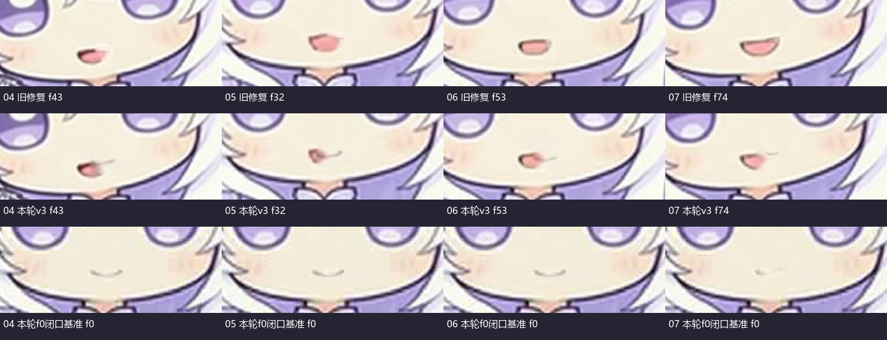
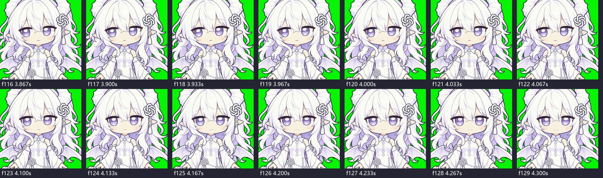
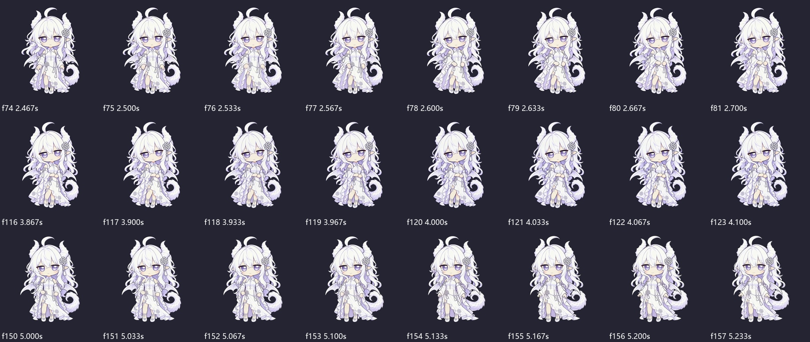

# GPT娘补充动作再次复验

2026-11-03。本次按最新物理文件审查：02为19:22交付的v4，04—07为v3；两桥新增8秒拼接演示。没有把较早的02 v3或上轮v2当成本轮新成品。

**结论：仍不通过整批验收。02串版已解决；04—07依然有可直接证明的嘴部修复错位；两桥只补演示，原动作未修。01、03、08保持原哈希和既有候选状态。**

## 本轮实际做了什么

- 五条最新候选完整解码780帧MP4＋780帧真实透明WebM，共1560帧；五份BIN按解码alpha>10、小端bit独立重算，逐位差异全部0。
- 新桥段演示另完整解码240帧MP4＋240帧WebM，共480帧。总计本轮新解码2040帧。
- 01 v2、03、08 v2及两条已等比修复桥的原片/WebM/BIN均与上一轮审核的版本逐文件SHA一致。不重复解码无变化的整套素材。
- 检查脸部逐帧图、透明浅深底抽样、变化峰值及重点连续帧；没有完成全批原速GUI/正式桌面接播或用户视觉认可。明确失败项由解码帧直接证明。
- 本会话没有调用生成API、上传原片、执行交付脚本、修改正式目录或重启桌宠。

## 逐条判断

|条目|本次结论|事实|
|---|---|---|
|01 呼吸 v2|继续保留候选|原片、透明视频、BIN哈希不变。|
|02 倾听 v4|串版修复通过；动作暂不完全通过|原片与WebM同帧抽样的偏头/手位一致，闭口可见，蒙版匹配。但仍出现偏头和4.0—4.2秒较集中的回正，未达到本版“头颈肩全程固定、只有耳眼动”的方案。不再用帧差平均下降当动作自然的证明。|
|03 尾摆|继续保留候选|三件套哈希不变。|
|04 理发 v3|不通过|第43帧/1.433秒，旧嘴左侧开口仍在，新唇线画到其右侧，出现残留开口加侧边线。|
|05 合手 v3|不通过|第32帧/1.067秒，同样保留一侧粉色开口；新细线没有替代原嘴，而是偏在旁边。|
|06 换重心 v3|不通过|第53帧/1.767秒仍有有面积的开口轮廓，附近新增细线；不是上下唇真实收合。|
|07 注意用户 v3|不通过|第74帧/2.467秒仍有粉色孔洞与旁边的线，未做成承诺的单一闭口笑弧。|
|08 困倦 v2|继续保留候选|三件套哈希不变，不重复为已解决的开口/长闭眼重新生成。|
|B→A桥|比例修复保持；中段仍不通过|三件套哈希与上一轮相同，原2.567→2.600秒的手、袖姿态集中变化仍在。本轮只有诊断图和拼接演示，没有修动作。|
|A→C桥|比例修复保持；中段仍不通过|三件套哈希未变，原1.100→1.133秒的手臂、衣袖/躯干快速改形仍在。|

## 04—07：本次问题更具体，是局部修复没有对准并覆盖原嘴

下图第一行是上轮v2，第二行是本轮v3，第三行是本轮各片f0的真正闭口基准。修复后的嘴确实缩小了，但仍有粉色开口，新唇线还偏到一侧。不是要求所有帧都长得与f0一样，而是必须只剩一个自然闭合的嘴形，不能保留开口再补一条线。

原片和最终透明视频都能看到残留；因此不是只有检查图导错或压缩显示造成。将暗腔灰度提亮、把修复线画得更细，均不能解决旧嘴没有完整消除的问题。

建议**停止整批批量重试**，先只修04第43帧：按这一帧的真实头部位置找原嘴完整边界，删除全部开口及轮廓，恢复一致皮肤，再画对齐的单一闭合线。先把一个具体帧做对，再验证前后各5帧跟踪、边缘、颜色和表情连续，之后才推广到整条及另外三条。不能再只交“暗腔0、100%保真”的自评。

## 02 v4：同源包装成立，但锁头方案没有实际实现

当前MP4为4,813,553字节，SHA `c370554f0f7b1f48cdf136ef85bdcc5dc14a79cad71ff0f20788119523380ba6`；WebM为558,163字节，SHA `dd4e22874c3564c7bd8d45c6fdd51116deb9674852e136976be36fc27397c7d8`。与本版元数据一致；首末PNG精确匹配本轮解码的原片首末帧，五份蒙版中本条也逐位通过。

同帧对照没有再发现上一轮两个不同表演混装的情况。这一步应承认修好了。

但116—129帧可见实际头仍偏斜，约120—126帧即4.0—4.2秒回正。不能沿用报告“零偏头、全程绝对垂直”的说法，也不能据此认定导致集中回正的动作分支已被取消。这里的变化分布在数帧，并不是完全无中间帧；仍需要真实原速判断手感，不能把任何局部峰值一律称为跳切。

另一个需要纠正的制作输入：本版 `prompt-submitted.txt` 开头实际写着 `anime catgirl maid`、`long black dress`，与白发白紫长裙龙娘不符。实际视频仍保持主要白裙龙娘外观，不能据这段文字虚构已经换装；但下一次制作应先消除提示词身份冲突，不能把错误模板继续传给生成器。此次是否保留v4供用户试看片，可与“符合固定头方案”分开记录。

## 两桥新增演示：只证明拼接文件已交付

新演示为240帧/8秒/30fps，正好是B→A桥120帧＋A→C桥120帧。它没有加入真实B待机→桥→A待机→桥→C待机的上下文，也没有测试正式宿主的路由、加载、命中或中断。

拼接点在第119→120帧附近相对接近；两条桥各自内部的集中变形仍存在。下图依次是B→A内部、两个桥的拼接点、A→C内部。不能用中间拼接点IoU较高来替两处内部动作通过。

交付说明中还把frontidle写为B、把C写为侧向托腮/relax；项目现有C参考是frontidle正面放松。必须按真实A/B/C参考帧核对，不要靠中文姿态名猜路由。原等比映射保留，不再次修改人物比例来掩盖动作。

## 当前正式状态与交付建议

本轮只读快照：正式启用版本 `0.8.14-electron`，44状态/44媒体，本批 `c_*` 与 `bridge_*` 未注册；包清单267项SHA一致，启用指针中的清单SHA一致。本轮不改变这个状态。

本次对通过部分的判断仅为：技术转换、命中蒙版、02同源与保留候选的文件保全。整批美术和正式接入未通过。下一步优先用单帧/短连续段证明04嘴部修复能正确对齐，避免继续重复整批交付。01、03、08不重做；02保留真实v4单独评原速；两桥保留等比成果，修/验原中段而不是继续生成更多同样拼接文件。
