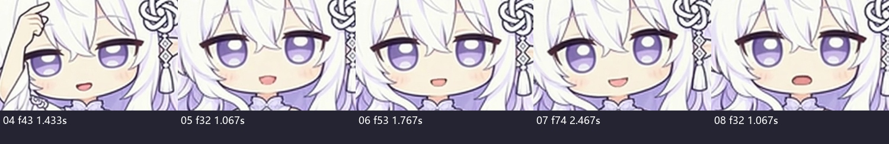
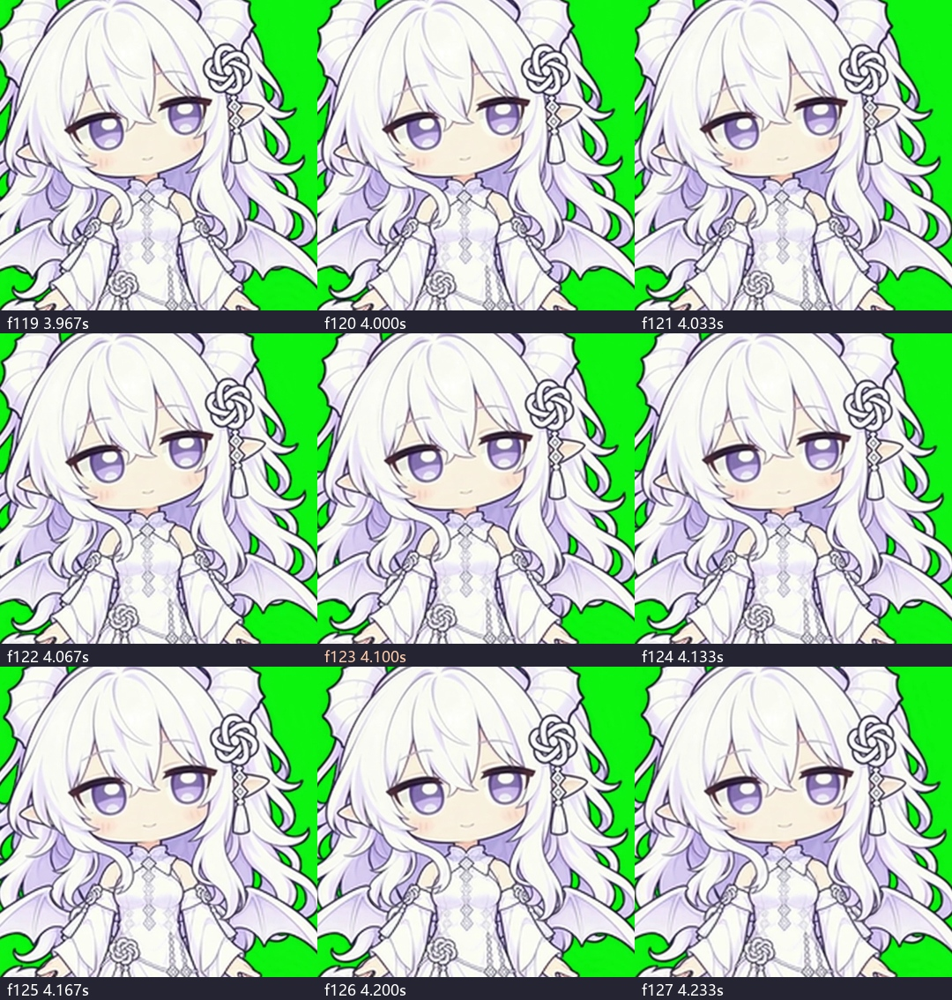
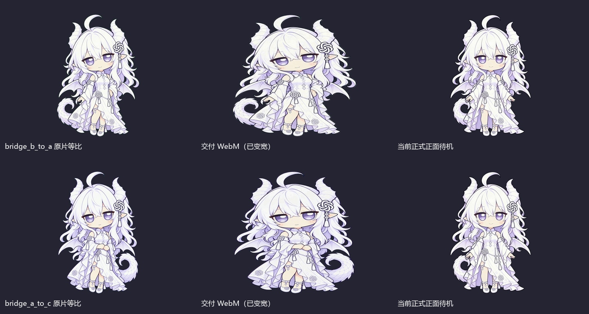

# Gemini补充动作最终交付复核

2026-11-03。审查用户截图指定目录：`C:\Users\33750\Documents\Codex_产出\DeepSeek桌宠\GPT娘菜单与待机优化-20261103\新素材交付_20261103`。采用01、02的v2，其余采用当前目录版本，共8条微动作＋2条姿态桥；不是“万页归序”等六条精品设计的交付。

**结论：文件转换确已完成，但不通过整批美术验收。01新版呼吸与03尾摆保留为候选；02、04—08以及两条桥段需处理后复验。**

## 核查到的实物

- 10条MP4、10条WebM、10份BIN均存在；完整解码1500帧原片和1500帧透明视频，共3000帧。
- 01/02 v2为960×960、180帧、30fps、6秒；03—08为960×960、150帧、30fps、5秒；两桥为782×1176、120帧、30fps、4秒。WebM均为384×384，解码帧数与各自源片一致。
- WebM真实解码出透明通道；10份BIN均为384×384逐帧、alpha>10、小端bit打包的命中蒙版，**与重新解码的alpha逐位比较，差异全部为0**。BIN不是另一个视频或高清母版。
- 10对WebM/BIN与截图第二处Gemini工作区镜像逐文件SHA一致。首末PNG均匹配本轮独立解码的原片首末帧。
- 原片、WebM、BIN在各条审查前后SHA不变。没有执行交付者提供的处理脚本，没有调用生成API，没有上传原片。

这些结果证明文件与蒙版交付成立；不能证明动作符合导演要求、无口型、无形变或原速观感已经通过。

## 逐条结果

|条目|判断|证据与下一步|
|---|---|---|
|01 呼吸眨眼 v2|保留候选，原片闭口检查通过|逐帧脸部图未见旧版反复开口；约1.8秒、3.37秒有两次完整眨眼。透明浅/深底抽样可用。保留本版，不继续随机重做；还需最终原速接播/实际桌面观感确认。|
|02 动耳倾听 v2|回正返工|闭口已改善，但第122→123帧，即4.0667→4.1000秒，头、眼线、发束、肩部同步快速回正，主要回正量挤在少数帧。不是完全没有过渡，仍未做到提示词承诺的长段连续缓回。|
|03 尾尖轻摆|保留候选|主事件可见，尾圈也明显松开展开，幅度超过仅尾尖轻摆；抽查未见同类开口问题。先保留，原速确认幅度与接点，不因别条失败整批重做。|
|04 手理额发|闭口版不通过|第43帧/1.433秒明确开口；多个时间抽样也有开口。手理发的主事件做出来了，不等于所提交的闭口版本完成。|
|05 双手相合|闭口版不通过|第32帧/1.067秒明确开口。合手主事件存在，保留可用动作价值；后续精查手指/袖口接触，修正闭口后再验。|
|06 微换重心|闭口版不通过|第53帧/1.767秒明确开口；动作起段相邻变化集中。不能只凭下缘包围盒宣称“零滑步”，下缘包含裙摆。|
|07 注意用户|闭口版不通过|第74帧/2.467秒明确开口微笑。该开口本身不等于人物损坏，但与实际提交提示词承诺的全程闭口不一致，不能自评为闭口PASS。|
|08 克制困倦|不通过|第32帧/1.067秒开口，约2.3—3.2秒时间抽样连续闭眼；与闭口、短暂微眨的目标不符。|
|B→A桥|当前透明成品不通过|原片竖画布被直接压成正方形，人物明显变宽；中段约2.567→2.600秒手势/袖口变化仍需修顺。必须先修非等比映射，再审完整B→桥→A接播。|
|A→C桥|当前透明成品不通过|同样有非等比变宽；约1.100→1.133秒手臂、躯干、衣袖快速改形。尾巴跨侧运动需原速连续性复验。|

原任务禁止说话口型，08明确闭嘴；交付者自己实际提交的各条提示词进一步统一承诺“全程闭口”。因此04—08按其承诺版本不通过，不把“张嘴”泛化为一切表情素材都不可用。保留原片；若用户以后另选开放嘴部表演，按新的目标再判断。

## 两条桥新增的严重问题：非等比压缩

原片画布782×1176，输出384×384，横向缩放384/782、纵向缩放384/1176。两者不相等；相对原比例，横向宽高比扩大 **1176/782≈1.5038，即约50.4%**。

本轮既读取到处理脚本的直接 `resize((384,384))`，也在真实解码WebM上确认变形，不只是根据文件尺寸猜测。下图把各自前景都等比归一到同一高度，仅用于比较形体；中列明显更宽、更扁。第三列为本轮读取的当前正式frontidle首帧。

修复应保留原片，使用**全片固定、等比缩放＋透明补边/平移**，按当前正式B/A/C的身体尺度、脚底和中心映射；禁止逐帧自动居中、裁去尾翼或把新脸重绘成另一比例。修后重新生成WebM及其BIN并验证。此项首先是本地后期修复，不需要为转换错误重新付费生成。

## 实际安装状态：存在并行变更

不能照搬截图中“未触碰正式目录”的描述。审查中先实际读到：启用指针为 `0.8.11-electron.1`，其scenes与animation均有54项，本批10条全部注册，安装媒体SHA与交付WebM一致；当时8条微动作在清单自动池里，两桥只是注册成素材。

随后在本轮再次读取时，**同一启用版本的清单已恢复44项，本批10条注册已移除**。这是审查期间发生的并行文件变更；本会话没有执行安装、回退、重启或写入正式目录，也没有足够证据归因具体执行者。最终安装快照见 `evidence/installed-state.json`。已经运行的进程是否加载过旧清单，本轮未实测，不能由磁盘状态替代。

在这一44项的最终快照中，启用指针的包清单哈希一致，包清单内267项文件SHA均一致。这是只读文件完整性核查，不是重新启动应用或视觉验收。

桥段生成/注册也不等于A路由已经打通。读取到的performance-catalog仍只有原A→B、B→C、C→B边；未据此确认新B→A/A→C被实际调度。具体运行接入应另做行为验证。

## 对“全部做好”的判断

可以确认的是：原片、透明视频和蒙版都已交齐，并且蒙版确实匹配。不能确认或直接不符合的是：全程闭口、所有回正自然、两桥保持人物比例、无缝接播、A路线已打通，以及整批美术PASS。

5秒/960的03—08低于建议6—8秒/1024，是需如实说明的规格差异，不单凭此否定动作；不允许复制帧、变速或放大凑规格。首末MSE小也不能证明过程无突变，非零误差更不能写“100%像素相同”。

**本轮的限制：**完整解码、所有01/02脸部帧图、全批时间抽样/变化峰值和透明浅深底抽样已核查；没有完成全批原速GUI播放、真实桌面接播、多背景全帧艺术验收或用户视觉认可。上述明确不符合项不依赖原速播放即可由帧证据证明；保留候选不等于正式美术验收通过。

建议保留01 v2和03；先修两桥的本地比例转换，再依用户授权处理02回正及04—08闭口。完整返工要求见同包《给Gemini的返工单.md》。
