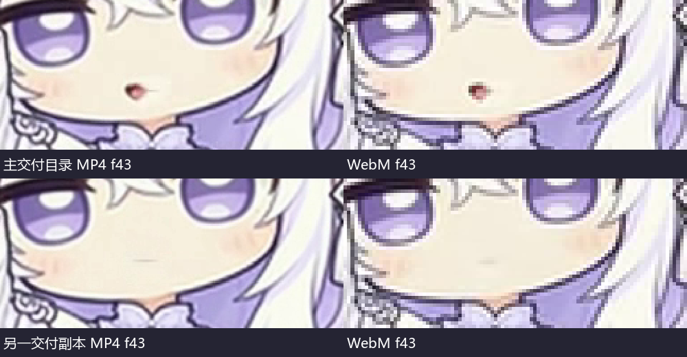
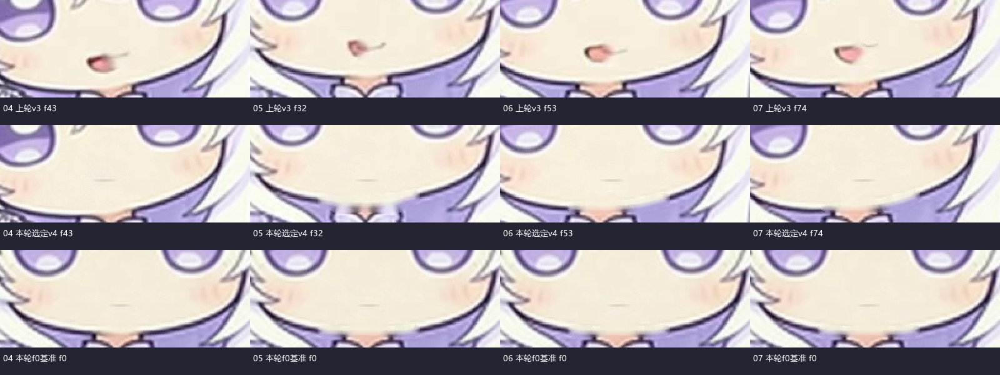

# 本轮验收：嘴部修复通过，04必须选对副本

2026-11-03。实物范围为04—07 v4。本轮没有把上轮v3拿来判断v4；发现04同名v4存在两套不同视频后，又对说明书明确列出的另一交付副本做了独立完整检查。

**结论：选定正确副本后，04、05、06、07的“残留开口／偏侧双重唇线”缺陷检查通过，可保留为候选，不需要为这些旧缺陷继续批量重做。整批仍不能写成全部艺术验收或正式接入完成：02回正与两桥中段没有更新，原速实屏接播仍未验收。**

## 04确实修好了一份，但主目录里放着另一份

两个目录同叫 `04_c_brush_fringe_v4`，其内容不同：

|位置|MP4字节数|WebM字节数|第43帧实际表现|结论|
|---|---:|---:|---|---|
|`GPT娘菜单与待机优化-20261103/新素材交付_20261103/04_c_brush_fringe_v4`|2,498,398|657,470|原片和透明成品均仍有可见开口，38—48帧也残留|不选用这一份|
|`GPT娘补充动作第四次验收-20261103/04_c_brush_fringe_v4`|3,505,879|790,702|原片及透明第43帧闭合，逐帧嘴部检查未见上轮残留开口|**选用这一份**|

下图上排为主目录副本，下排为另一交付副本；两列分别为真实MP4/WebM的第43帧。不是“同一视频在播放器中表现不同”，而是两套不同SHA的视频。

正确04目录的三件套：

- MP4 SHA：`8684973994e4a82d38392d0779b4354bea45239048e237e5ba7aff168f540038`
- WebM SHA：`2fa453501b9f17b941906158ddab6cad7792d05ee2a5de570dc978dda307f5f9`
- BIN SHA：`4047a9d58d293d0d011815a53872f2270773bc5d71e4f9ead5c6acf50e2c6fc8`

说明书实际列的是这套正确副本的字节数/哈希；主交付目录及其Gemini工作区镜像却是另一套。无需再生成04，先纠正目录索引与交付回执。**本轮只记录选用路径，没有覆盖或删除任何一套原片。**

## 本轮选用清单

|动作|选用目录|本轮明确结果|
|---|---|---|
|04 理额发|`%USERPROFILE%\Documents\Codex_产出\DeepSeek桌宠\GPT娘补充动作第四次验收-20261103\04_c_brush_fringe_v4`|上轮第43帧开口及偏侧线缺陷已解决，保留候选|
|05 双手相合|`%USERPROFILE%\Documents\Codex_产出\DeepSeek桌宠\GPT娘菜单与待机优化-20261103\新素材交付_20261103\05_c_hands_rest_v4`|上轮第32帧及过程开口缺陷已解决，保留候选|
|06 换重心|同主目录下 `06_c_small_weight_settle_v4`|上轮第53帧及过程开口缺陷已解决，保留候选|
|07 注意用户|同主目录下 `07_c_notice_user_v4`|上轮第74帧开口、旁边另画线的缺陷已解决；闭口表情较克制，最终笑意可读性另看原速|

完整路径、三个文件各自字节数和SHA见同包 `本轮选用版本.json`。它是后续取文件的依据，不能只凭“v4”文件夹名选择。

## 实际检查与限制

1. 主目录四条v4完整解码各150帧原片及150帧WebM；另对正确04副本再次完整解码150＋150帧。本轮共解码1500帧，四个选用成品涵盖其中1200帧。
2. 五套被检查的视频均384×384透明输出、150帧、30fps、5秒，与各自960×960修复后MP4时序长度一致。所有五份BIN均按真实解码alpha>10、小端bit重算，逐位差异0；边界alpha未超过10。
3. 对选定四条的原片，人工查看了全部600帧嘴部裁片；另核对旧缺陷帧、脸部/时间抽样、透明浅深底和变化峰值。正确04还单独核对了真实导出MP4与WebM第43帧。没有把内存处理图、灰度统计或AFTER标签当作实片证据。
4. 局部唇线较淡，是否足够有表情、是否在实际尺寸下自然，仍属于原速观感项。没有完成全批原速GUI、正式桌面接播、多背景全帧美术验收或用户视觉认可。因此本次“通过”只指明确的嘴部修复缺陷与候选文件技术检查。
5. 01 v2、03、08 v2三件套SHA均不变，继续保留，不重复生成；02 v4和两桥三件套也未变，沿用上一轮未完成项：02仍有4.0—4.2秒集中回正，两桥原中段动作未修。不能因为04—07这次修好了就把其他项目一并写PASS。

## 当前正式状态

本轮只读快照：`0.8.14-electron`、44状态/44媒体，本批 `c_*`、`bridge_*` 均未注册；267项包文件SHA一致，启用指针的包清单SHA一致。本会话没有调用生成API、上传原片、修改正式安装或重启桌宠。

建议停止04—07的旧缺陷返工，以本轮选用清单锁定成品，再按实际需要做原速接播/试配。02与桥段独立处理，避免再让一条未完成项拖着其他已成立的素材全部重做。
