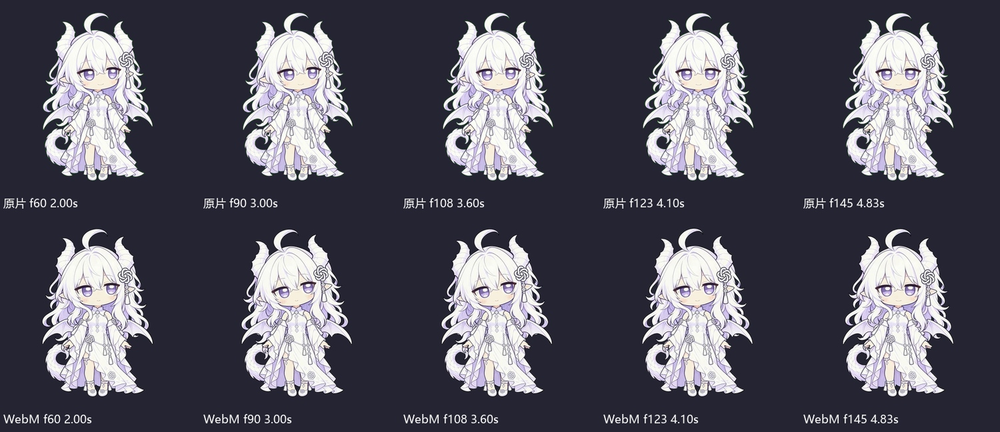
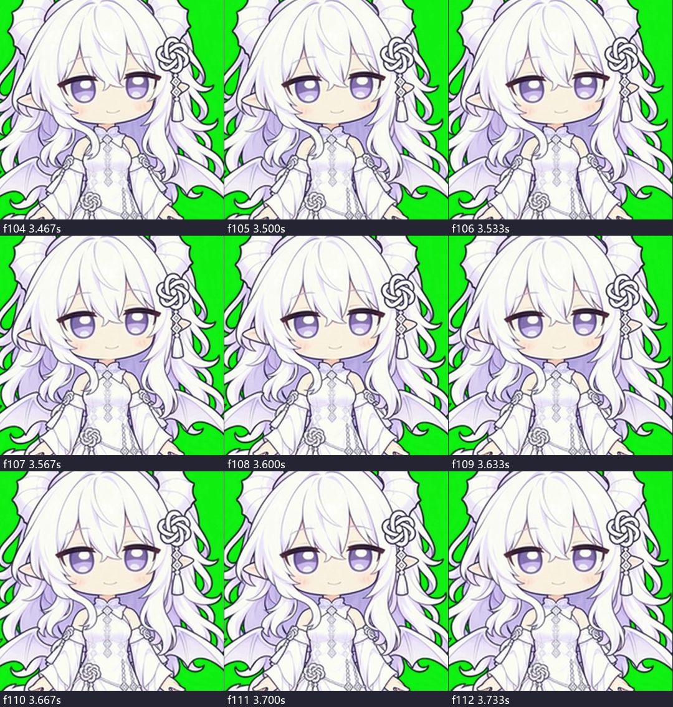
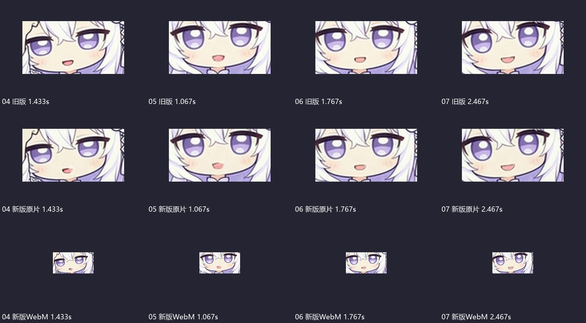
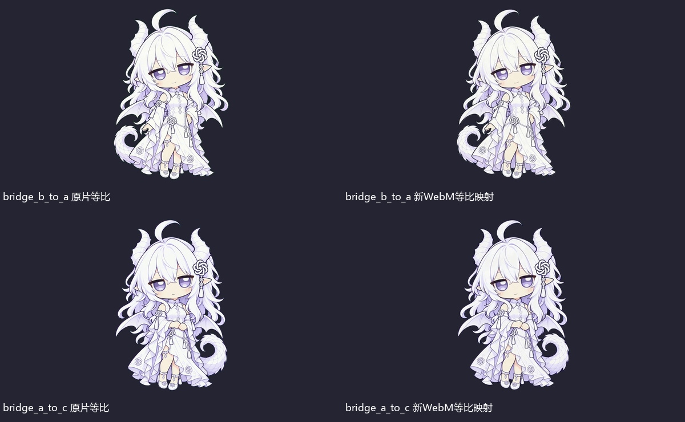
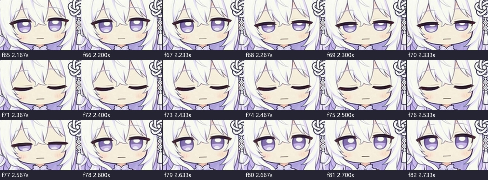

# Gemini返工交付再次验收

2026-11-03。对象为原目录最新回执指定的01 v2、02 v3、03原版、04—08 v2及两条等比修复桥。本轮依据实际文件重新检查，不以 `REWORK_DELIVERY_RECEIPT.md` 的自评作为通过证据。

**结论：有实质改进，但仍不通过整批验收。01、03保留；08上一轮明确问题已解决，加入保留候选。两桥的比例修复通过，动作中段与接播仍待处理。02串版、04—07嘴形仍不合格。**

## 实际检查范围

- 对8条发生变化的候选重新完整解码1170帧MP4及1170帧透明WebM，共2340帧。01/03未重复全量解码，而是核对原片、WebM、BIN三件套SHA，均与上一轮完全一致。
- 8条更新候选的WebM均384×384，帧数/帧率与对应MP4一致；真实alpha可解码，每份BIN按解码alpha>10、小端bit重新计算，逐位差异均为0。02边界alpha最大1，其余为0，均未超过命中阈值10。
- 递归核对工作区各版本子目录，8条更新后的WebM/BIN均能找到同SHA镜像；根目录同名文件部分是旧版，不能混用。原片与透明文件“同目录存在、帧数相同”仍不能证明是同一版表演。
- 检查所有更新微动作的逐帧脸部图、时间抽样、相邻变化峰值、浅深底透明抽样，以及重点连续帧。全批原速GUI和真实桌面接播仍未完成，不把统计结果写成最终用户视觉认可。
- 本轮没有调用生成API、上传原片、执行Gemini交付脚本、改正式安装或重启桌宠。

## 逐条结论

|条目|本轮结论|已修好与仍欠缺|
|---|---|---|
|01 呼吸眨眼 v2|继续保留候选|三件套哈希不变，沿用上一轮原片/透明候选结论，不继续重生成。|
|02 动耳倾听 v3|不通过：交付串版|当前MP4是新API微偏头版本；同目录WebM却是较早的旧v2光流重定时版本。动作峰值、偏头角与回正时间都不同。当前新原片107→108帧、3.5667→3.6000秒也有集中回正，应单独复验，不能用另一版曲线替它通过。|
|03 尾摆|继续保留候选|三件套哈希不变，尾摆幅度与接点仍待最终原速确认，不整批重生成。|
|04 理额发 v2|闭口修复不通过|第43帧/1.433秒，深色口腔变浅，但上下唇间的开口轮廓仍在，呈粉色开口，不是闭合唇线。|
|05 合手 v2|闭口修复不通过|第32帧/1.067秒同样保留粉色开口区域；手部主动作保留，不因嘴形返工丢弃其价值。|
|06 换重心 v2|闭口修复不通过|第53帧/1.767秒仍是有面积的开口形状。1.133秒附近的身体起动仍较集中，修嘴后要看原速，不凭指标声称零滑步。|
|07 注意用户 v2|闭口修复不通过|第74帧/2.467秒，笑的开口外形仍在。涂浅口腔不等于上下唇闭合；需保留笑意、改成闭口笑弧。|
|08 克制困倦 v2|上一轮明确缺陷修复通过，保留候选|逐帧脸部图保持闭口；第71—76帧可见完整闭眼，共约6帧/0.2秒，77帧开始睁开，78帧已睁眼。旧版长闭眼和开口已解决；后续只做最终原速与接播验收。|
|B→A桥|比例修复通过；整条暂不通过|固定等比缩放补边已消除原50.4%变宽；源MP4哈希不变，所以原2.567→2.600秒手/袖变化并没有被这次比例修复解决。|
|A→C桥|比例修复通过；整条暂不通过|比例恢复，蒙版匹配；源MP4哈希不变，原1.100→1.133秒的衣袖/躯干改形仍须处理或原速确认，完整A→桥→C接播未通过本轮验收。|

## 02：两个不同的v3被混在同一目录

当前候选目录 `02_c_listen_ear_v3`：

- MP4：5,204,332字节；元数据写明 `strategy: micro_tilt`、seed `2026110362`，是新API候选。
- WebM：784,359字节，与工作区 `output_webm/02_c_listen_ear_v3/` 的较早透明版一致；该子目录留存另一份3,348,357字节的母版MP4。
- 回执写的是旧v2第118—140帧经“流形余弦缓出”重构为96—154帧的版本。读取实际 `scratch/build_v3_candidate.py` 可见 `DISOpticalFlow`、`remap`、双向混合和重采样；这属于光流插帧/重定时，不能同时声称“不插帧、不慢放”。本轮没有执行该脚本。

以下同一帧号上下对照，3秒等位置的偏头和手位不同，已直接证明不是同一表演的格式转换。不是编码器引起的小色差。

正确处理：先指定唯一真实母版，分别独立命名“API原生版”和“后期重构版”；后者如保留必须明确来源及算法，不能用它的曲线证明前者。按选定母版重新产出WebM、BIN、首末图、曲线、提示词/制作记录和SHA，完整审真实回正。不要为包装混乱直接再花钱生成一轮。

## 04—07：检测指标解决了颜色，没有解决闭口形状

新文件确实有局部修补，不能说完全没做。但灰度阈值下“暗腔0像素”仅证明深色区域被提亮；修后保留了开口边界及粉色内面。在原片和最终透明WebM上均可见。

应将上下唇真实收合，旧口腔内部重建为与周围匹配的下脸皮肤，只留细而自然的闭合唇线/笑弧，并跟随头部运动。不要把粉色开口重新命名为“精致唇线”。用人工看几何形状及连续表情，而不是继续调灰度阈值来得到PASS。无需无差别重生成整段手/身体动作。

## 确实修好的部分

两桥新映射约为全片固定缩放0.3432，782×1176→268×404，再放到384×384；与之前非等比压缩不同。同高图中形体恢复。本轮所有解码帧的边界alpha未超过10，未发现命中轮廓裁边。此结果不等于脚底生物力学或原速接点已通过。

08此次不是“整批继续失败”：它的闭口和短眨眼在实际帧中成立，保留，不再为旧缺陷重做。

## 正式版与交付记录

本轮只读快照为 `0.8.13-electron`、44状态/44条媒体；本批 `c_*`、`bridge_*` 均未注册。包清单267项SHA一致，启用指针的包清单SHA一致。本轮未写入正式目录。此快照不替代对其他会话历史操作的归因，也不宣称用户当前已运行进程的逐帧状态被观察。

首末PNG存在用途混杂：02 v3匹配当前MP4解码首末帧，其余部分是处理前/编码前/透明缩放后的图，不与当前MP4解码像素完全相同。单凭不相等不否定动作，但必须清楚标注“原片首末/透明首末/编码前参考”，不能拿错版本图片证明当前视频。

交付回执也须修正：02的原生API与光流后期描述不能混写；04—07不能再用暗腔0宣称闭口；两桥只能写“比例修复”，不能写整条运动/接播完成。按实际母版、算法、文件SHA和独立版本目录重新开回执。

**下一步：**保留01/03/08；先解决02串版和04—07嘴形；两桥保留已修复映射，仅处理或验证中段连续性与完整接播。详细交给Gemini的短单见同包另一文件。
